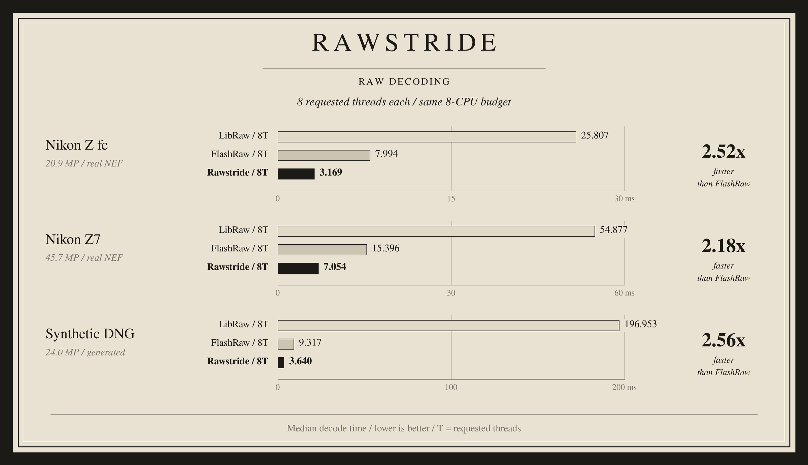
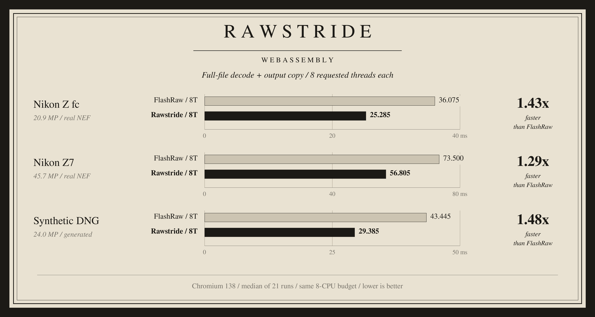

# Rawstride

**Fast RAW decoding. Native and in your browser.**

Available for Linux x86-64 and WebAssembly.

## Native



**2.18x-2.56x faster than FlashRaw** on the three tested packed-14 inputs.

## Browser



**1.29x-1.48x faster** including output copying.
[Zero-copy results](plates/rawstride-web-zero-copy-8t.png): **1.69x-1.96x faster**.

Measured on an AMD EPYC 9V74 VM with the same eight-CPU budget and eight requested
threads per decoder. Medians of 21 runs across three blocks; FlashRaw 0.1.0.
Browser results use Chromium 138. Decoded sensor output matches the reference.
Timings cover parsing and sensor decoding with the input already in memory.

## Try it

```bash
./bin/linux-x86_64/rawstride-decode photo.NEF 7 8
python3 web/serve.py
```

For the browser, open `http://127.0.0.1:8080/` and select a file.
Files stay in your browser. See [browser usage](web/README.md).

The native arguments are input file, timed iterations and requested threads.
Append an output filename to save the complete sensor plane:

```bash
./bin/linux-x86_64/rawstride-decode photo.NEF 1 8 sensor.u16
```

Output is little-endian unsigned 16-bit sensor data, without a header. Dimensions
are printed with the timing results.

## Compatibility

- Native executables: Linux x86-64, glibc 2.38+, `libstdc++.so.6` with
  `GLIBCXX_3.4.29`, `libgomp.so.1` and `libz.so.1`.
- Browser: tested in Chromium 138. Serve over localhost or HTTPS.
- `rawstride-benchmark-zen4` is the native benchmark configuration and requires
  an EPYC 9V74-compatible CPU. Use `rawstride-decode` for general x86-64 use.
  The native plate reports the benchmark configuration.

## Verify

```bash
sha256sum -c SHA256SUMS
./bin/linux-x86_64/rawstride-selftest
```

## Third-party notices

This release includes LibRaw under its CDDL-1.0 option. Copyright and license
notices are in `notices/`. Corresponding LibRaw sources are distributed
separately as `rawstride-libraw-source.zip`.
